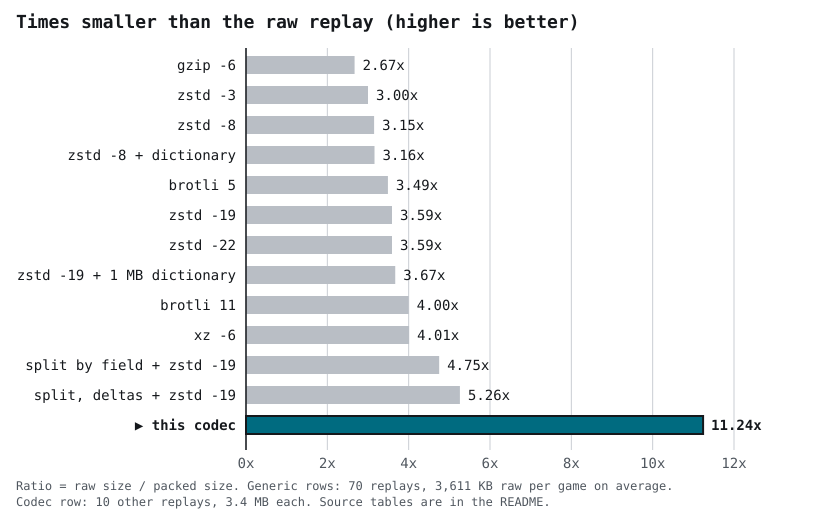

# PAC Replay Codec

Packs a [Pokemon Auto Chess](https://github.com/keldaanCommunity/pokemonAutoChess) replay up to 12.4x smaller
than the raw file\*, and about 3.6 times smaller than zstd -8. Lossless: unpacking gives back the exact bytes,
checked by size and crc32 before anything is returned.

\*Smaller files compress slightly worse. On 100 sample replays, packed one by one: worst 10.2x, median 11.4x,
best 12.4x.

Two ways to use it:

1. **In the browser:** <https://donaldgallianoiii.github.io/pac-replay-codec/>. Drop replays (or a whole folder)
   on the page, get `.paczd` files back. Drop a `.paczd` and you get the original. It runs in your browser and
   nothing is uploaded. Good for a handful of games up to a few hundred.
2. **In a terminal, for bulk:** one command packs every replay in a folder and its subfolders, on all your cores,
   and checks each one byte for byte. Needs Node 22.18 or newer, nothing else:

   ```sh
   npx github:DonaldGallianoIII/pac-replay-codec pack ./replays
   ```

   The npm package (`npx pac-replay-codec`) is waiting on npm's review. Until it is live, use the `github:` form
   above: same tool, same results.



## Who it is for

Everybody's use case is different. Two we had in mind:

1. **You keep a lot of replays.** They are 2 to 5 MB each and they add up. Packed, the same drive holds about
   11 times as many, and every one comes back bit for bit.
2. **The game itself.** If PAC stores replays, an 11x smaller store is a storage bill cut by about the same
   factor. Players downloading a replay wait for a tenth of the bytes.

## The numbers

Every compressor we tried on whole replays. Ratio is raw size divided by packed size, so higher is smaller.
CPU is seconds per GB of raw replay on one thread of a Ryzen 9 7950X3D.

| Method | KB per game | Ratio | Pack s/GB | Unpack s/GB |
| --- | ---: | ---: | ---: | ---: |
| gzip -6 | 1,350 | 2.67x | 24.5 | 1.93 |
| zstd -3 | 1,205 | 3.00x | 2.5 | 0.64 |
| zstd -8 | 1,146 | 3.15x | 9.3 | 0.66 |
| zstd -8 with a 110 KB trained dictionary | 1,142 | 3.16x | 10.1 | 0.67 |
| zstd -19 | 1,005 | 3.59x | 195 | 0.72 |
| zstd -22 | 1,005 | 3.59x | 216 | 0.74 |
| zstd -19 with a 1 MB trained dictionary | 983 | 3.67x | 234 | 0.75 |
| brotli 5 | 1,034 | 3.49x | 13.0 | 1.76 |
| brotli 11 | 903 | 4.00x | 1,377 | 1.84 |
| xz -6 | 901 | 4.01x | 190 | 9.40 |
| 70 replays as one zstd -19 stream, long window | 918 | 3.93x | 303 | 1.48 |
| Split by field, then zstd -19 | 760 | 4.75x | not measured | not measured |
| Split by field, numbers as change from last, then zstd -19 | 687 | 5.26x | not measured | not measured |
| **This codec** | **303.9** | **11.24x** | **54.9** | **46.7** |

Across 100 sample replays packed one by one with the shipped code: worst 10.2x, median 11.4x, p90 12.1x, best
12.4x, 11.4x in aggregate.

Samples: the generic rows are 70 replays (3,611 KB raw per game on average), with dictionaries trained on 30
other replays. The codec row is a separate set of 10 replays (3.4 MB each, 34.2 MB in all). An earlier prototype
of the codec, on a wider set of 312 replays, averaged 11.19x, from 9.77x to 15.08x, every one byte exact.

Per replay that is about 0.3 s to pack and 0.2 s to unpack in a fresh process, and 0.19 s and 0.16 s once the
engine has warmed up. Packing one replay holds about 55 MB of memory.

## How it works

A replay is a recording of a Colyseus game state: a handshake with the type table, the full state at join, then
about 16,000 patches and a stream of messages. Generic compressors look for repeated byte strings, and there are
few. The redundancy is in the structure: the same field changes the same way tick after tick.

The codec reads the type table from the file's own handshake, walks every patch field by field, and predicts each
value from what came before. An adaptive binary range coder writes only how wrong the guess was. Unpacking runs
the same model in reverse. For replays of game version 6.11 it also uses the game's own formulas for the carousel,
portals and avatars, which takes another 20% off (380.1 KB per game with the schema alone).

[FORMAT.md](FORMAT.md) describes the container and the coded stream.

## What we tried that did not help

So nobody has to try them again.

1. **A trained zstd dictionary.** 3.16x against 3.15x without one. Nothing.
2. **zstd on top of the packed output.** 0.006% bigger at level 3 and at level 19, on the 10 benchmark replays.
3. **A pre-trained starting model.** Files come out 5.6% smaller (286.9 KB against 303.9), and every packed file
   then depends forever on one exact 396 KB model file. Only about 4% of a packed file is the coder learning at
   all, so the ceiling is near 6%. The slot is in the format; no model ships and it is off.
4. **Interleaved coder states.** 2, 4 and 8 states were 3% to 34% slower than one, in native code. The next
   context depends on the bit just decoded, so there is nothing to overlap.
5. **Two format switches.** `ByteFlag` and `TreeOrdinal` each buy about 3% of speed for 0.7% to 0.9% more size.
   Both are off.

## Honest costs

1. **CPU.** It is slower than zstd in both directions. Packing costs about 6 times the CPU of zstd -8, unpacking
   about 70 times. Unpacking has to replay the whole model; zstd only copies bytes. For one replay that is still
   a fraction of a second.
2. **No random access.** You unpack the whole file. A replay viewer reads the whole file anyway.
3. **Game versions.** Measured on 6.11 replays. The type table is read from each file, so later versions with
   new fields should pack exactly; they lose the mini-game formulas and come out about 20% larger until a build
   knows them. Replays from v7 are not yet tested.
4. **The format is tied to the model.** A change to the model needs a new format version byte, and a build must
   keep the old one to read old files.

## How to use it

### The page

Hosted at <https://donaldgallianoiii.github.io/pac-replay-codec/>. To run it yourself, serve the `web/` folder
(module workers do not load from `file://`):

```sh
python3 -m http.server 8000 --bind 127.0.0.1 --directory web
```

Then open <http://127.0.0.1:8000/>. Any static file server works, at the root or under a subpath; every path in
the page is relative. The page and its code make no network requests, and the page's content security policy
blocks connections from it. The policy is set in the page, so it covers the page; its background workers take
their policy from the server, which is why the code itself never makes a request either.

`web/lib/` is `src/` with the types stripped. After you change `src/`, run `node tools/build-web.mjs` to rebuild
it (Node's own type stripper, nothing to install). A test fails if you forget.

### The library

No dependencies and no Node-only calls, so it runs in Node and in browsers. Install it from GitHub (the npm
package `pac-replay-codec` is waiting on npm's review; once it is live, `npm install pac-replay-codec` works too):

```sh
npm install github:DonaldGallianoIII/pac-replay-codec
```

```js
import { packReplay, unpackReplay } from 'pac-replay-codec';

const packed = packReplay(originalBytes).bytes;   // Uint8Array in, Uint8Array out ("CLRZ" container)
const original = unpackReplay(packed);            // throws if the packed bytes are damaged
```

`packReplay` never fails. An input that is not a replay, or that would not shrink, is stored as it is inside the
container. `unpackReplay` checks the size and the crc32 of what it rebuilt. It returns the original or throws.
It never returns something else.

The npm package is plain JavaScript (`web/lib/`) with TypeScript types (`types/index.d.ts`). From a clone you
can also import the TypeScript source,
`./src/index.ts`, which Node 22.18 or newer runs directly.

### Command line and AI agents

`pac-replay-codec` packs, unpacks and verifies many replays at once. Node 22.18 or newer, no other
dependencies.

This is the tool for bulk conversion: point it at a folder of any size.

```sh
npx github:DonaldGallianoIII/pac-replay-codec pack ./replays                 # every .colreplay under ./replays
npx github:DonaldGallianoIII/pac-replay-codec pack ./replays -o ./packed --jobs 4
npx github:DonaldGallianoIII/pac-replay-codec unpack ./packed -o ./restored
npx github:DonaldGallianoIII/pac-replay-codec verify ./packed --json
```

Once the npm package is live, `npx pac-replay-codec ...` is the same command, shorter. To get a plain
`pac-replay-codec` command, run `npm install -g github:DonaldGallianoIII/pac-replay-codec`. From a clone, run
`node cli/pac-replay-codec.mjs` with the same arguments.

What it promises, whatever the flags:

1. **Originals are never deleted or changed.** Outputs go next to each input, or under `-o` with the folder layout
   kept. An output that already exists is skipped, never replaced, so running it twice is safe.
2. **A pack counts only when it is exact.** Each packed file is unpacked again and compared byte for byte with the
   original before it is written.
3. **Already packed files are skipped** by `pack`, found by their first bytes, not their name.
4. **The same inputs print the same lines in the same order**, however many threads ran. `--jobs` defaults to
   the number of cores minus one.

`verify` writes nothing. A `.paczd` must unpack exact; a `.colreplay` must pack and come back exact.

Packed files are recognised by their first four bytes, not their name, so files named `.clrz` by pre-release
builds unpack and verify the same way. Folder walks pick up both names.

For scripts and AI agents, `--json` prints one line per file and a summary line last. This is a real run on one
of the small synthetic test files (a real replay comes out near 11x):

```sh
node cli/pac-replay-codec.mjs verify test/fixtures/synthetic-schema5.colreplay --json
```

```json
{"file":"test/fixtures/synthetic-schema5.colreplay","out":null,"status":"verified","in_bytes":19705,"out_bytes":4483,"ratio":4.4,"exact":true,"error":null}
{"summary":true,"files":1,"exact":1,"skipped":0,"failed":0,"in_bytes":19705,"out_bytes":4483,"ratio":4.4}
```

`out` is the written file for `pack` and `unpack`, and `null` for `verify`.

`status` is `packed`, `unpacked`, `verified`, `skipped` or `failed`. `ratio` is always original size over
packed size, in every command. In the summary, `in_bytes` and `out_bytes` are those two totals.

Exit codes: **0** every file exact or skipped, **1** at least one failed, **2** bad usage. A path that does not
exist counts as a failed file (exit 1), not as bad usage. `--help` prints all of this with examples.

### Tests

The repository holds no recorded games. The tests run on two small synthetic replays in `test/fixtures/`, written
by `test/make-synthetic.cjs` from Colyseus's own encoder (schema 4 and 5) with a made-up schema that is not a game.

```sh
node --test test/*.test.ts                                   # 26 tests, a few seconds
REPLAY_DIR=~/my-replays node --test test/codec.test.ts       # plus 3 that run on your own .colreplay files
```

The format lock in `test/codec.test.ts` holds the sha256 of the packed fixtures. If a change moves it, the
change is a format change (see [FORMAT.md](FORMAT.md)).

## Credits and license

Built for [Pokemon Auto Chess](https://github.com/keldaanCommunity/pokemonAutoChess). The game-aware layer (the
carousel, portal and avatar formulas) is derived from the game's code, which is GPL-3.0, so this is GPL-3.0 too.
See [LICENSE](LICENSE). Not affiliated with the game's authors.

`src/trig.ts` uses the kernel polynomials of fdlibm and keeps its notice (Sun Microsystems, 1993). The page uses
Archivo and JetBrains Mono, both under the SIL Open Font License (`web/fonts/`).
